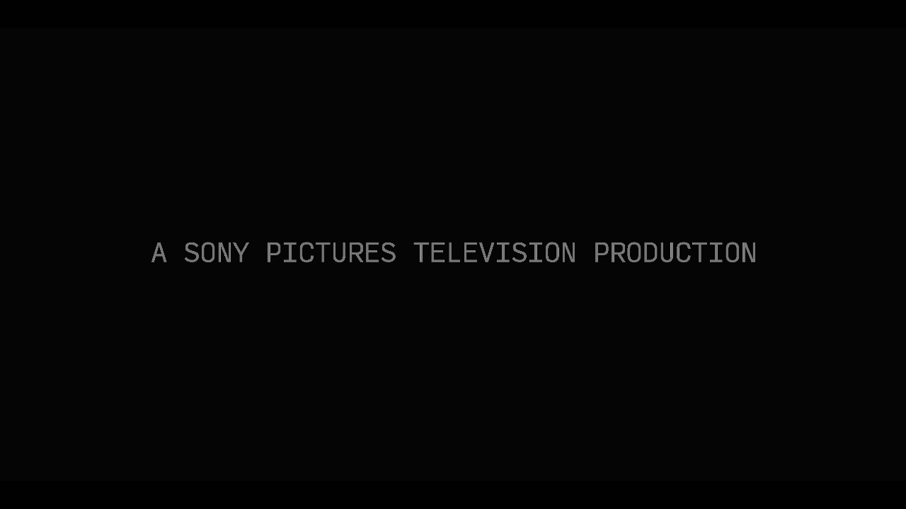
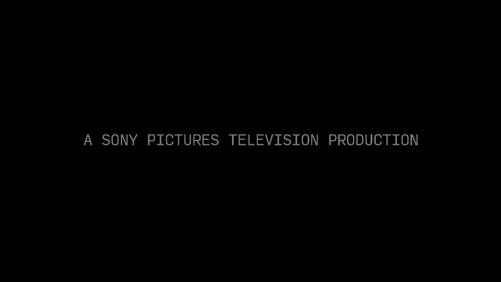

# The problem, measured evidence, and kernel correction

**Finding:** a host-driver hardware/cache mismatch could leave the T7 VADJ1 brightness stage enabled during Dolby Vision bypass. Correcting that mismatch restored the known-good dark background on the **same paused frame**, without a reboot or Dolby-module reload.

This page explains the symptom, shows the saved evidence, identifies the code responsible, and describes how maintainers can incorporate the tested correction. The [installer guides](README.md#download-and-install) are for end users; the [source patch](0001-amvecm-t7-reconcile-vadj1-dv-bypass.patch) and [build guide](BUILDING.md) are for integration.

## What users saw

On the Fire TV Cube 3, the first DV playback after a reboot normally looked correct. Later starts could lift the darkest video areas and leave them raised until a reboot. The number of good starts varied. Both Plex and Kodi's direct player could develop the problem, including repeated plays of the same file. Menus and letterbox bars often stayed black even when the video area lifted.

The tested setup processed Dolby Vision metadata and reported **HDR10 HDMI output** to a Samsung TV without native Dolby Vision. The intended solution had to retain that processing and output path. Lowering the TV's black level or disabling DV was not the correction.

## The captured evidence

These are the **original saved PNG conversions**, with no added exposure, contrast, crop, or enhancement. They show one paused Sony title card at **5.705 seconds** during a controlled test of the patched kernel:

| Fault reproduced: correction disabled | Same frame: correction restored |
|---|---|
|  |  |
| Hardware `0x3`; cached enable `0`; background **Y21** | Hardware `0x2`; cached enable `0`; background **Y17** |

This is **not** a mislabeled first-play/second-play pair: the failure was deliberately recreated with the guard disabled, then reversed by enabling it on the same paused frame. There was no playback restart, seek, or reboot between these two captures. That control isolates the correction more tightly than comparing two separate starts.

The difference is subtle in a browser, so the raw readings are supplied as well. Both samples used the same 1280×720 NV12 capture path, settings, and 48,000-pixel background region, away from the title text and letterbox bars: **x=400..879, y=200..299**, origin at the top left.

| Readback | Fault reproduced | Correction restored |
|---|---:|---:|
| `pq_vadj1_sync` | `N` | `Y` |
| Brightness value written to reproduce the fault | `0`, already `0` | No further brightness write |
| Internal DV bypass mode, `dv_pq_bypass` | `2` | `2` |
| Requested DV-bypass VADJ1 enable | `0` | `0` |
| Cached `pq_cfg_cur.vadj1_en` | `0` | `0` |
| Hardware `VPP_VADJ1_MISC` (`0x3280`) | `0x3` | `0x2` |
| Hardware enable bit 0 | **1: enabled** | **0: bypassed** |
| Background Y minimum / median / maximum | **21 / 21 / 21** | **17 / 17 / 17** |
| Correction-request counter | `15` | `16` |
| DV processing active | Yes | Yes |
| Reported HDMI output | HDR10 | HDR10 |
| Native debug override, `debug_bypass_vpp_pq` | `0` (automatic) | `0` (automatic) |

The table's write of zero occurred only while reproducing the fault. The normal installed fix does not write a brightness offset. The internal `dv_pq_bypass` state and the similarly named debug override are different controls; they are shown separately.

**Measurement meaning:** Y17 and Y21 are **internal 8-bit VDIN capture codes**, not nits, not raw 10-bit PQ values, and not an independent measurement of the HDMI wire or TV light output. Y17 is the known-good result for this frame and this capture conversion; it is not a universal target for all content. Numeric measurements come from the NV12 luma plane, not from RGB PNG pixels.

### Verify the readings yourself, without a Cube

Download the repository's [readings JSON](evidence-readings.json), [verification script](verify-evidence.py), both PNGs above, and the matching [raised NV12 buffer](evidence-vadj1-raised.nv12) and [restored NV12 buffer](evidence-vadj1-restored.nv12) into one folder. Alternatively, clone/download the current repository. Run:

```bash
python3 verify-evidence.py
```

The script uses only Python's standard library. It verifies image/buffer SHA256 hashes and recalculates the same ROI's minimum, median and maximum. It performs no network operations or hardware writes. Expected output:

```text
raised: 48000 samples, {'minimum': 21, 'median': 21, 'maximum': 21}, VADJ1=0x3
restored: 48000 samples, {'minimum': 17, 'median': 17, 'maximum': 17}, VADJ1=0x2
Both image/buffer checksums and all published ROI readings match.
```

The capture files contain 2,048 trailing bytes beyond canonical 1280×720 NV12 storage; these are outside the luma plane and are excluded. Hashes cover the complete original files. Private playback URLs, credentials, boot identifiers, and personal settings are omitted from the public readings.

### Was the entire picture being lifted?

A separate earlier comparison matched a moving scene near 10 minutes using frame stepping, not timestamps alone. In that dark scene, the measured change concentrated near black:

| Good captured Y range | Pixels compared | Raised minus good |
|---|---:|---|
| 16–20 | 85,680 | Median +2, range 0..+3 |
| 21–25 | 157,743 | 99.952% identical; remaining pixels +1 |
| 26–35 | 119,219 | All identical |
| 36–60 | 21,057 | All identical |
| 61–100 | 372 | All identical |
| 101–160 | 329 | All identical |

[Machine-readable scene analysis](evidence-near-black-analysis.json). This was a separate 1,000-nit-target trial, with settings held constant within its good/raised pair; the controlled title-card pair above used 2,150 nits. Neither target prevented the original fault. The scene had few bright pixels and did not test peak HDR highlights. Its result supports a near-black alteration in those internal captures, rather than a uniform gain increase across the whole picture.

## The kernel issue: two writers, one stale cache

The relevant files are in the host Amlogic media driver, **outside `dovi.ko`**:

| File / function | Relevant behavior |
|---|---|
| `drivers/media/enhancement/amvecm/amvecm.c`: `video_adj1_brightness_store()` | Writes brightness and enables VADJ1 in hardware, even for an unchanged value of zero. |
| Same file: `video_adj1_contrast_store()` | Also enables VADJ1 when writing contrast. |
| `drivers/media/enhancement/amvecm/amve.c`: `vpp_pq_ctrl_config()` | Uses `pq_cfg_cur.vadj1_en` to decide whether a requested enable change requires a hardware write. |
| Kodi `CAMLCodec::SetVideoRect()`, `SetVideoBrightness()`, `SetVideoContrast()` | Enables VADJ1 and writes the sysfs controls as video settings are initialized/applied. |

Primary source: [common_drivers brightness/contrast stores](https://github.com/CoreELEC/common_drivers/blob/f9af0b41d6da6cd501b75c33bf44338693195d96/drivers/media/enhancement/amvecm/amvecm.c#L843-L931), [common_drivers PQ-control source](https://github.com/CoreELEC/common_drivers/blob/f9af0b41d6da6cd501b75c33bf44338693195d96/drivers/media/enhancement/amvecm/amve.c), and [the installed Kodi revision's AMLCodec.cpp](https://github.com/SamuriHL/coreelec-xbmc/blob/aa9f70523e02f5a169b22c17d48f37d763416e0a/xbmc/cores/VideoPlayer/DVDCodecs/Video/AMLCodec.cpp). The tested host source additionally includes all 17 SamuriHL release patches; see [exact build provenance](BUILDING.md).

In this Kodi revision, normal UI brightness/contrast **50** map to sysfs value **0**. Its per-codec cached values initialize to `-1`, so applying the normal defaults can still issue sysfs writes on a new playback. Writing kernel brightness `0` in the diagnostic control is not setting Kodi's UI brightness to zero.

On the tested T7 path, the brightness store contains:

```c
WRITE_VPP_REG_BITS(VPP_VADJ1_MISC, 1, 0, 1);
```

That sets bit 0 to one. It does not update the bypass cache to reflect that side effect. Meanwhile, the PQ controller's original condition was:

```c
if (pq_cfg_cur.vadj1_en != pq_cfg.vadj1_en) {
    /* update the cache and write the requested enable bit */
}
```

If both the cached enable and DV bypass request are zero, that condition is false—even if the other writer has enabled the real hardware.

The observed failure sequence was:

1. DV bypass requests VADJ1 off and the cache reaches `0`.
2. A brightness/contrast sysfs write enables the actual stage. Writing an unchanged brightness of `0` reproduced this.
3. The cache remains `0`; a subsequent requested-off comparison can skip its write.
4. Hardware remains enabled: `VPP_VADJ1_MISC = 0x3`, with the measured background at Y21.

Refreshing the native bypass path restored hardware `0x2` and Y17 without a reboot. This was reproduced twice before the patch. Resetting or genuinely unloading/reloading the separate Dolby module had not cleared the symptom, which is consistent with the mismatch being in the host's picture-processing state.

The complete ordering of every earlier startup was not traced. Timing-dependent ordering is a plausible explanation for why one route sometimes survived more starts, not a separately demonstrated universal sequence. We also do not claim to have derived the enabled VADJ1 stage's full transfer function from these two values.

## The tested fix

The [exact source patch](0001-amvecm-t7-reconcile-vadj1-dv-bypass.patch) adds `t7_dv_vadj1_needs_sync()` and extends the existing VADJ1 condition in **both** applicable non-S5/T3x branches of `vpp_pq_ctrl_config()`:

```c
if (pq_cfg_cur.vadj1_en != pq_cfg.vadj1_en ||
    t7_dv_vadj1_needs_sync(pq_cfg.vadj1_en, vpp_index)) {
    /* existing cache update and direct/RDMA register write */
}
```

The helper requests reconciliation only when **all** of these hold:

| Gate | Tested value / reason |
|---|---|
| `pq_vadj1_sync` | `true`, default on; permits the controlled off/on comparison |
| `is_meson_t7_cpu()` | Limits the new behavior to the tested CPU family |
| `vpp_index` | `0`; hardware read is for the tested VPP0 register |
| `dv_pq_bypass` | `2`, the STB DV bypass state |
| Requested VADJ1 enable | `0`, so ordinary requested-on operation is preserved |
| Actual `VPP_VADJ1_MISC` bit 0 | `1`, proving the live hardware still needs disabling |

It then reuses the existing `WR_VCB` direct-write or `WR_DMA`/vsync-write path. In the measured correction, `0x3 → 0x2` clears the enable bit while preserving the other bits. The patch does not reset the whole VPP, change Dolby tables or metadata, compensate with a black offset, or force VADJ1 off outside the gated bypass state. It works on every applicable configuration pass, so it is not tied to filenames, Plex, or a playback-count script.

Runtime diagnostics:

```text
/sys/module/aml_media/parameters/pq_vadj1_sync
/sys/module/aml_media/parameters/pq_vadj1_resyncs
```

The first should be `Y` in normal use. The second counts **requested reconciliation writes**, not independently observed unique hardware transitions or frames. An RDMA write may be queued; the counter alone does not prove it was applied. The controlled comparison above includes actual register and pixel readback.

## Integrating it into another build

1. **Start with that release's exact source and configuration.** For our baseline this means Linux `69e87fa…`, common_drivers `f9af0b4…`, and all 17 September 28 SamuriHL driver patches. A newer branch needs its own source review; do not assume identical line numbers or register ownership.
2. **Apply from the common_drivers repository root:**

   ```bash
   git apply --check /path/to/0001-amvecm-t7-reconcile-vadj1-dv-bypass.patch
   git apply /path/to/0001-amvecm-t7-reconcile-vadj1-dv-bypass.patch
   ```

   Retain the helper's gates and both direct/RDMA condition changes. If rebasing, review semantic equivalence rather than accepting a partial application. The supplied patch was checked to produce byte-identical `amve.c` to the compiled test kernel.
3. **Rebuild the matching host kernel**, not just `dovi.ko`. Use that release's kernel source, configuration, toolchain and normal image packaging. [BUILDING.md](BUILDING.md) and the source release asset contain our pinned inputs and reproduction scripts. Export CRC matching is useful but not a substitute for boot and behavioral tests.
4. **Validate the corrected state.** Confirm DV processing and intended output remain active; capture the same visible frame and background ROI. Compare the DV bypass request, cache and actual VADJ1 enable bit. On our baseline, a same-zero-brightness challenge with the guard enabled returned to hardware `0x2` / Y17. A deliberate guard-off challenge reproduced `0x3` / Y21, then guard-on restored `0x2` / Y17 on the held frame. These are maintainer controls, not end-user setup steps; leave the guard enabled afterwards.
5. **Test normal repeated playback and recovery.** Restart the same file and different files, using both Plex and the native player. Include runs without capture/tracing. Check that ordinary SDR/HDR10 and menu operation recover normally after stopping. Native DV output and other chips require their own validation before broadening the patch's scope.

Do not reuse this release's kernel image or build-specific kernel-memory diagnostic addresses on another release. Maintainers should include the **source correction** in each matching build. A reboot retains it; an OS update retains it only if the replacement kernel also contains it.

## Validation on the first Cube

| Boot | Dolby module / test | Result |
|---|---|---|
| 1 | Source-built module; 6 measured starts, 6 deliberate zero-brightness challenges | All corrected captures Y17; guard off Y21, back on Y17 |
| 2 | Source-built module; 4 starts without capture, then one measured start | Fifth start Y17; first four were not individually measured |
| 3 | Original proprietary module; 3 measured starts, 3 zero-brightness challenges | All corrected captures Y17; off Y21, on Y17 |
| 4 | Source-built module restored; 2 measured starts | Both Y17 |

Total: 16 starts, **12 measured starts**, and 9 measured deliberate challenges across four boots. Driver/library tracing was off during these runs. Afterwards, the user visually confirmed two episodes played twice each through Plex, with normal blacks on all four plays.

All **15,886** freshly generated exported kernel CRCs matched the original Cube. There were no new compiler/modpost warnings against the unchanged baseline. Android boot-v0 header/load addresses and the exact initramfs were preserved; only kernel size and standard boot ID changed in the header. Original roundtrip and LZO decompression checks passed.

## Second Cube

The distribution installer was applied to another Cube on the same exact release with the **original proprietary Dolby module preserved**. Backup, installation, reboot, image checksum, and running guard were verified. The user then confirmed normal playback: “perfect. working great.” No exact playback count was recorded for that confirmation.

## Earlier tests that did not fix it

- Original versus reconstructed Dolby module alone.
- Genuine normal Dolby-module unload/reload, native control-path reinitialization, host unregister/register, and Kodi restart.
- Engine toggles, LUT-refresh request, refresh-rate changes, and 1,000-nit peak target.
- Bypassing the soundbar and connecting directly to the TV.
- Native Kodi versus Plex playback; both could develop the fault.
- Continuous capture. It did not prevent the fault.

Generated Dolby settings, matrices, LUTs, metadata, and input fingerprints matched between good and raised samples. Frame matching later showed the lift concentrated near black, with midtones and brighter details unchanged in those internal comparisons. These findings redirected the investigation to host-side picture processing.

## Limits

The tested output was DV processing with HDR10 HDMI output to a non-DV Samsung TV. Native DV output, other SoCs/VPPs, and a broad SDR/HDR regression suite remain unvalidated. Normal menu/non-DV recovery was checked: the original VADJ1 enable state returned outside the gated DV bypass condition. Capture comparisons do not independently measure the HDMI signal or the TV's light output.

The working AM6B Plus reference was kept unchanged throughout the experiments.
